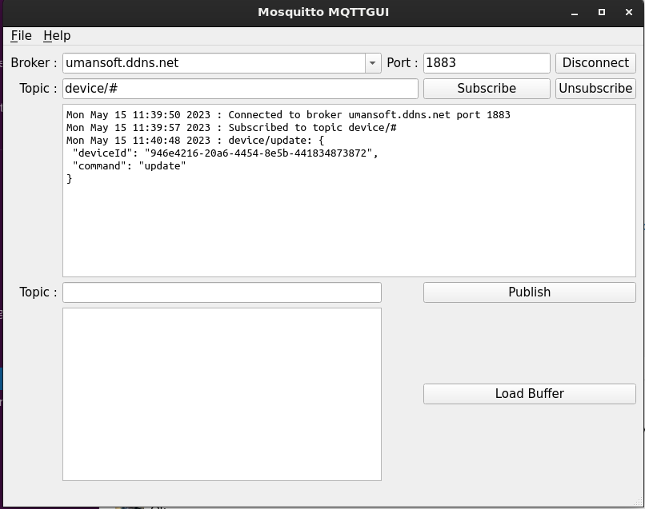

# mqttWrapper Project

## Overview

This repository contains the code used to create an MQTT connection with a broker. This project uses the `mosquitto client` MQTT library to provide the MQTT connection.

## mqttgui

The mqtt GUI application demonstrates the usage of the mqtt wrapper class.



## Debug logging

Verbose Qt and Mosquitto logging is disabled by default. Enable it when configuring the build:

```shell
cmake -S . -B build -DENABLE_DEBUG_LOGGING=ON
```

When enabled, the application appends Qt and Mosquitto messages to `mqttwrapper.log` in its working directory.
